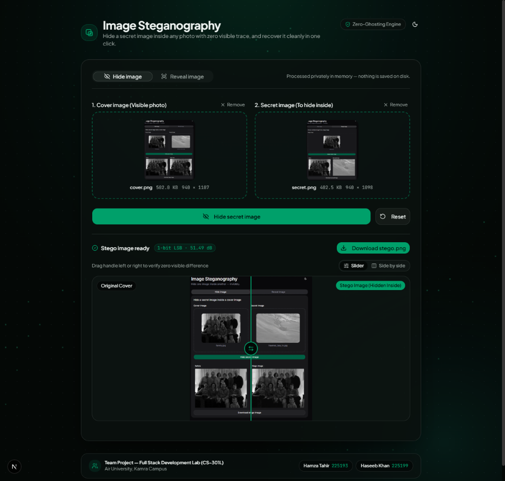
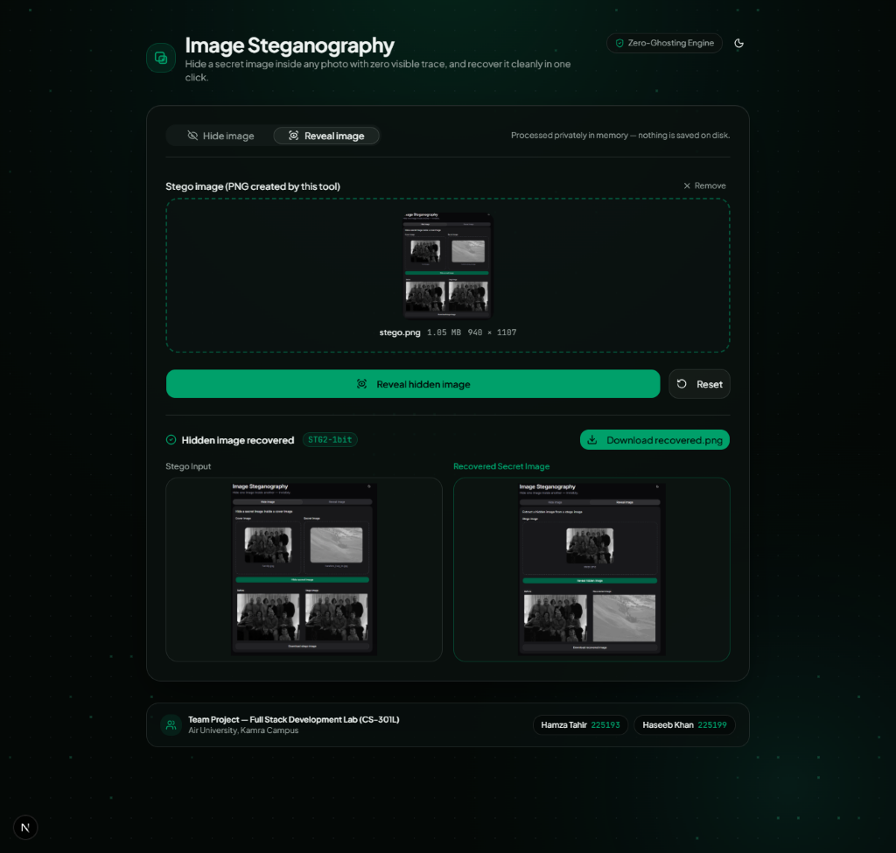
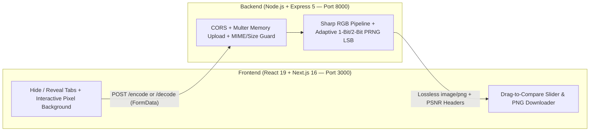

<div align="center">

# Image Steganography — Zero-Ghosting Studio

**Hide any secret image inside an ordinary photo with zero visible trace, and recover it cleanly in one click.**


*Full Stack Development Lab (`CS-301L`) Semester Project — Air University, Kamra Campus*

</div>

---

## Application Preview

<table>
  <tr>
    <td width="50%" align="center">
      <strong>Hide Image Studio (Zero-Ghosting + Compare Slider)</strong><br/><br/>
      
    </td>
    <td width="50%" align="center">
      <strong>Reveal Image Studio (Crisp Full-Quality Recovery)</strong><br/><br/>
      
    </td>
  </tr>
</table>

---

## Why Zero-Ghosting Matters

Traditional 4-bit LSB steganography changes pixel channels by up to **±15 out of 255** (~25 dB PSNR), leaving faint ghost outlines of the secret image visible when zoomed in.

Our **STG2 Adaptive Engine** ([`backend/steganography.js`](backend/steganography.js)) eliminates ghosting completely:

| Metric | Legacy 4-Bit LSB | Our STG2 Zero-Ghosting Engine |
| :--- | :--- | :--- |
| **Max Pixel Change** | ±15 / 255 (visible on zoom) | **±1 / 255** (1-bit LSB) — invisible to the human eye |
| **Visual Fidelity (PSNR)** | ~25 dB | **> 51 dB** (500× less distortion) |
| **Spatial Ghosting** | Faint outline visible in dark areas | **0% Ghosting** (deterministic Mulberry32 PRNG XOR whitening) |
| **Recovered Secret Quality** | Posterized 4-bit colors | **Crisp full-color recovery** at original detail |
| **Server Disk Storage** | Often temp files | **Zero disk writes** — strictly in-memory (`multer.memoryStorage()`) |

---

## System Architecture



---

## Key Features

- **Adaptive 1-Bit / 2-Bit LSB + PRNG Whitening:** Packs the secret image cleanly into the carrier's least significant bit plane with zero geometric silhouette.
- **Interactive Drag-to-Compare Slider:** Hardware-accelerated `clip-path` slider to inspect *Original Cover* vs *Stego Image* right in the browser (plus Side-by-Side mode).
- **Real-Time Quality Telemetry:** Displays the active embedding bit-depth and measured PSNR (`dB`) directly in the studio.
- **Interactive Pixel-Matrix Background:** Cursor-reactive canvas lattice that adapts cleanly to Dark and Light themes and respects `prefers-reduced-motion`.
- **Privacy First:** Uploaded cover and secret images live only in RAM for ~100ms and are never written to disk.

---

## Tech Stack

| Layer | Technologies |
| :--- | :--- |
| **Frontend** | React 19, Next.js 16 (App Router), TypeScript 5, Tailwind CSS v4, shadcn/ui (Radix UI), `react-dropzone`, `next-themes`, Lucide Icons |
| **Backend** | Node.js, Express 5, Multer (`memoryStorage`), Sharp, CORS |
| **Workflow** | Feature-branch Git workflow (`dev` → Pull Request Review → `main`) |

---

## Project Structure

```text
Image-Steganography-FSD-Lab/
├── backend/
│   ├── server.js              # Express API, CORS, Multer validation, /health, /encode, /decode
│   ├── steganography.js       # Zero-Ghosting STG2 adaptive 1-bit/2-bit PRNG LSB engine
│   └── package.json
├── frontend/
│   ├── src/
│   │   ├── app/
│   │   │   ├── layout.tsx     # Plus Jakarta Sans + JetBrains Mono fonts & ThemeProvider
│   │   │   ├── globals.css    # Emerald/obsidian design tokens & tactile motion rules
│   │   │   └── page.tsx       # Main Hide/Reveal studio dashboard & team attribution
│   │   └── components/
│   │       ├── pixel-field-bg.tsx  # Interactive hidden-pixel canvas background
│   │       ├── compare-slider.tsx  # Drag-to-compare & side-by-side image viewer
│   │       └── ui/                 # shadcn/ui primitives (Tabs, Button, Card, Badge, ThemeToggle)
│   └── package.json
├── docs/
│   └── screenshots/           # Live studio screenshots
└── README.md
```

---

## Getting Started

### Prerequisites
- **Node.js 18+** (comes with `npm`)

### 1. Start the Backend Server
```bash
cd backend
npm install
npm start
```
Backend runs at `http://localhost:8000` (check status at `http://localhost:8000/health`).

### 2. Start the Frontend Server
```bash
cd frontend
npm install
npm run dev
```
Open `http://localhost:3000` in your browser.

---

## API Reference

| Method & Endpoint | Request Payload (`multipart/form-data`) | Response |
| :--- | :--- | :--- |
| `GET /health` | — | JSON server & engine status |
| `POST /encode` | `cover` (PNG/JPG ≤ 10 MB), `secret` (PNG/JPG ≤ 10 MB) | Lossless `stego.png` + `X-Stego-Bits` & `X-Stego-PSNR` headers |
| `POST /decode` | `stego` (PNG/JPG ≤ 10 MB) | Lossless `recovered.png` + `X-Decode-Mode` header |

> **Tip:** Always share or keep the generated `stego.png` as a **PNG** file. Re-saving or sending through apps that recompress to lossy JPEG will alter the least significant bits.

---

## Team Project Attribution

| Name | Registration ID | Course & Campus |
| :--- | :---: | :--- |
| **Hamza Tahir** | `225193` | Full Stack Development Lab (`CS-301L`) — Air University, Kamra Campus |
| **Haseeb Khan** | `225199` | Instructor: **M. Fahad Qasim** · Semester: **BSCS VB** |
